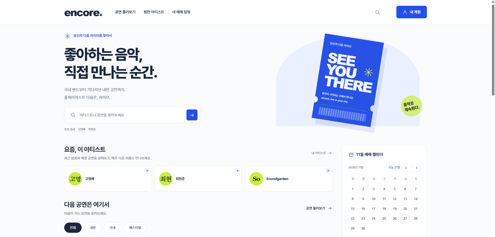
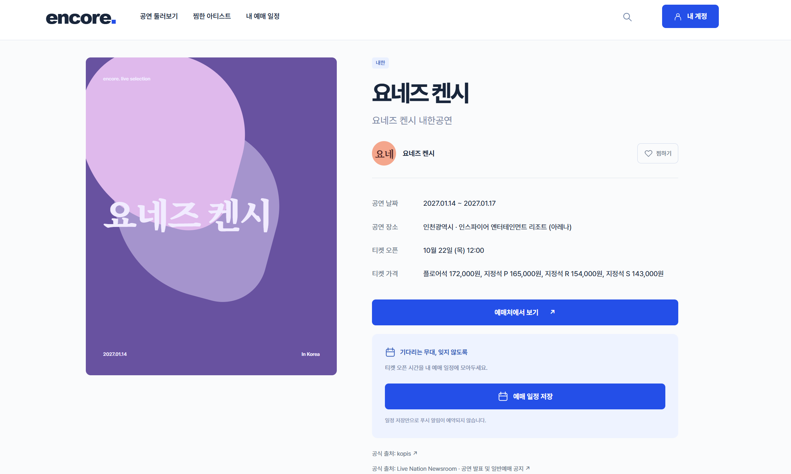
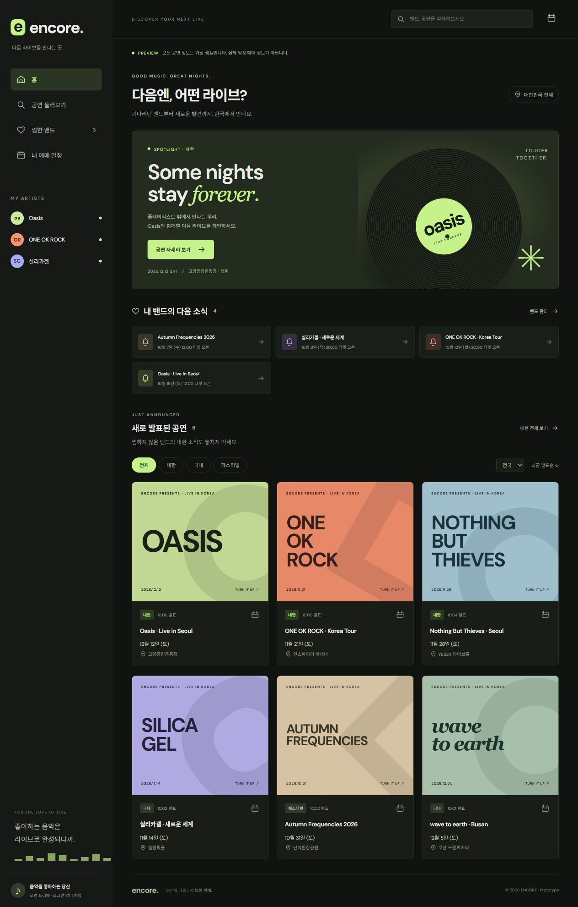

<div align="center">

# encore.

**좋아하는 음악, 직접 만나는 순간.**

국내 공연부터 내한 콘서트와 페스티벌까지.<br>
좋아하는 아티스트를 찜하고, 다가오는 공연과 티켓 오픈 일정을 한곳에서 확인하세요.


[](https://github.com/yeonguk0201/Concert_finder/actions/workflows/ci.yml)

[화면 둘러보기](#화면-둘러보기) · [빠른 시작](#빠른-시작) · [개발 로드맵](docs/development-roadmap.md) · [기여 가이드](CONTRIBUTING.md)

</div>

---

## 화면 둘러보기

### 홈



공연이나 아티스트를 검색하고, 추천 아티스트와 이달의 예매 캘린더를 둘러볼 수 있습니다.

### 공연 상세



요네즈 켄시 내한공연 상세 화면입니다. 공연 장소와 티켓 정보를 확인하고, 예매처로 이동하거나 예매 일정을 저장할 수 있습니다.

<details>
<summary>초기 프리뷰 화면 보기 · 가상 샘플</summary>



초기 UI 기록입니다. 화면 속 공연·라인업·가격·장소 조합은 가상 샘플입니다.

</details>

## 공연을 찾고 예매를 준비하는 방법

- **공연 탐색** — 아티스트 이름이나 별칭, 공연명, 공연장으로 검색하고 지역과 공연 유형으로 좁힙니다. 아티스트 프로필에서 검수된 소개와 공식 채널을 확인하고 관심 아티스트를 찜할 수 있습니다.
- **예매 일정** — 공연 상세에서 회차·장소·공식 출처를 확인하고 예매처로 이동합니다. 예매 시작 시각이 확인된 일정은 캘린더 파일(`.ics`)로 내려받을 수 있습니다. 미확인 시각은 미정으로 표시합니다.
- **계정과 알림** — 이메일로 로그인하면 찜과 저장한 일정을 다른 기기에서도 불러올 수 있습니다. 계정에서 알림 종류를 선택하고 수신 기기를 등록하면 저장한 일정의 예매 시작 1시간 전과 찜한 아티스트의 신규 공연 등록 시 알림을 받을 수 있습니다.

## 공식 정보가 화면에 오르기까지

KOPIS(공연예술통합전산망) API에서 받은 공연을 Node.js 수집기가 정규화합니다. 장소·날짜·실제 회차와 전체 출연진을 대조해 조건을 충족한 공연을 무알림으로 공개합니다. 출연진이 모호하거나 중복 가능성이 있는 후보는 검수 대상으로 남깁니다. 일반 수집·공개 경로는 AI 호출 없이 실행됩니다.

| 단계 | 구현과 검증 기록 |
| --- | --- |
| 수집·공개 | Cloudflare가 매시 23분에 GitHub Actions 수집기를 호출합니다. 첫 운영 실행에서 공연 5건의 비로그인 조회와 알림 발송 0건을 확인했습니다. [첫 공개 기록](docs/curation-runs/20261109-api-first-scheduler-first-run.md) |
| 공연 중복 표시 | 같은 공연으로 확인된 카드는 한 번만 표시합니다. 도시·날짜·장소가 다르거나 회차가 모호하면 별도로 표시합니다. [화면 수정 기록](https://github.com/yeonguk0201/Concert_finder/commit/ca26ba2) |
| 예매처 연결 | 공식 상품의 도시·장소·기간·모든 회차가 일치하면 비어 있는 예매 URL을 채웁니다. 수동 등록 링크는 보호합니다. [검증·적용 기록](docs/release/reviewed-booking-link-application.md) |
| 화면 갱신 | Supabase Realtime으로 공개 카탈로그와 본인 계정의 변경을 구독합니다. [구독 구조](docs/realtime-validation.md) |
| 웹 푸시 | 발송 직전에 동의·기기·공연 상태를 다시 확인합니다. 노트북, 갤럭시 Chrome, 아이폰 홈 화면 웹앱에서 테스트 알림을 수신했습니다. [기기 검증 기록](docs/notifications.md) |

**2026년 11월 25일 운영 점검** — 정기 호출은 확인됐습니다. 15:23 KST에는 KOPIS 목록 요청이 HTTP 400으로 실패했고, 16:23에는 재시도 대기 시간이라 수집을 건너뛰었습니다. 목록 요청 실패의 원인 확인과 보류 후보별 사유 저장이 남아 있습니다. [운영 점검 기록](docs/release/local-ui-and-concert-dedup-handoff.md#2026-11-25-후속-점검)

## 빠른 시작

Node.js **24**를 기준으로 개발·CI를 검증합니다.

```sh
git clone https://github.com/yeonguk0201/Concert_finder.git
cd Concert_finder
npm ci
npm run dev
```

개발 서버: `http://localhost:5173`

### 두 가지 실행 모드

| 모드 | 설정 | 데이터와 저장 |
| --- | --- | --- |
| 로컬 프리뷰 | Supabase 환경변수 두 값이 모두 비어 있음 | 가상 샘플 + 현재 브라우저의 localStorage |
| 계정 모드 | Supabase URL과 공개용 키 설정 | Supabase 공개 카탈로그 + 로그인 계정의 서버 저장 |

프리뷰의 모든 공연 정보는 `src/data.ts`에 있는 **가상 샘플**입니다. 화면과 캘린더 파일에 샘플 표시를 유지하며, 실제 계정으로 샘플 찜·일정을 자동 이전하지 않습니다. 계정 모드에서 조회 실패가 발생해도 샘플 데이터로 대체하지 않습니다.

### Supabase 연결

계정 모드는 스키마와 Auth가 준비된 Supabase 프로젝트에 연결합니다. 프로젝트 설정과 마이그레이션은 [백엔드 설정 안내](docs/backend-setup.md)를 참고하세요. 로컬에서는 `.env.example`을 `.env`로 복사해 두 값을 채우고, Auth의 리디렉션 허용 목록에 개발 서버 주소를 등록한 뒤 서버를 재시작합니다.

```dotenv
VITE_SUPABASE_URL=https://YOUR_PROJECT.supabase.co
VITE_SUPABASE_PUBLISHABLE_KEY=YOUR_PUBLISHABLE_KEY
```

**service_role·secret key·DB 비밀번호는 브라우저 코드와 `VITE_` 변수에 넣지 않습니다.** `.env`는 Git에 포함하지 않습니다.

## 개발과 검증

| 경로 | 역할 |
| --- | --- |
| [src](src) | React 화면, 카탈로그 조회와 변경 구독, 계정별 찜·일정·기기 관리 |
| [scripts](scripts) | 공식 공연 수집과 검증, 아티스트·예매 링크 검수 도구 |
| [supabase](supabase) | PostgreSQL 스키마, 행 수준 보안(RLS), 웹 푸시 Edge Functions |
| [tests](tests) | 공연 공개 조건과 권한, 계정 전환, 알림 및 화면 동작 회귀 검사 |

```sh
npm test
npm run lint
npm run build
```

작업 브랜치에서 검증한 변경은 `dev` 대상 PR로 통합하고, 출시는 `main` 대상 PR로 진행합니다. [기여 가이드](CONTRIBUTING.md)
