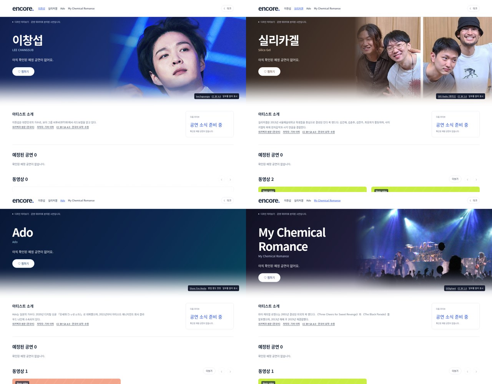
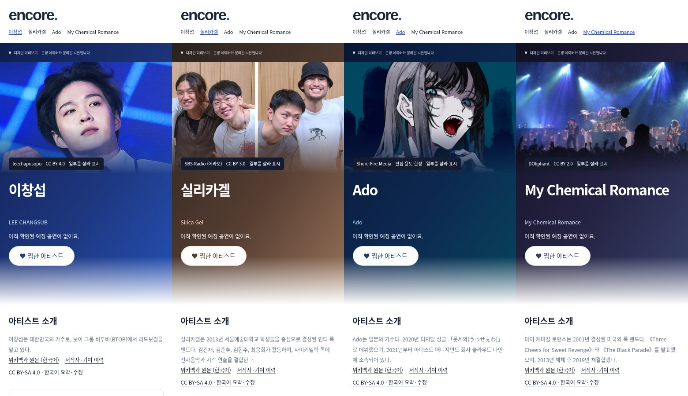

# 아티스트 상세 클라우드 준비 결과

2026-11-18 KST. 이 문서는 첫 화면 검토용 결과다. 반복 주기·자동 등록 범위는 정하지 않았으며 예약·배포·운영 콘텐츠 반영은 하지 않았다.

## 2026-11-19 KST · 새 채팅 인계 전 기준 브랜치 정정

초기 원격 dev 해시를 확인했으나 로컬 `origin/dev`는 `f9319139858de8029dd8028df6ea45dd334a5625`에 머물러 있었다. fetch 설정이 main만 추적하고 있어 이름만으로 최신이라고 판단한 것이 오류였다. 앞선 “최신 dev 기반” 설명과 초기 전체 검사 수치는 그 점을 감안해야 한다.

인계 전에 `git fetch origin refs/heads/dev:refs/remotes/origin/dev`로 실제 `ea6ab3d15bb573d2ccfadd0320170e3a7f2d256f`를 받은 뒤 그 커밋에서 같은 이름의 작업 브랜치를 다시 구성했다. 초기 커밋들은 로컬 보관 브랜치에 남기고, 원격에 공유할 브랜치는 실제 최신 dev의 후손이다. 최신 dev의 `src/ArtistMedia.tsx`, `src/ServiceDesign.css`, workflow, SQL은 변경하지 않았다. 시안 미디어와 CSS는 각각 `src/ArtistProfileMedia.tsx`, `src/ArtistProfilePilot.css`로 분리했다. 앞으로 시안 스타일은 이 CSS에서 수정한다.

현재 light 고정 상태이며 다크 모드 검정 전환은 **미구현**이다. 마지막 사용자 요청인 “색→흰색 변화가 급하고 본문 경계가 끊겨 보임”도 아직 미해결이다. [새 채팅 인계 문서](release/artist-profile-cloud-handoff.md)를 우선 읽는다. 이전 캡처는 수정 전 상태를 재현하는 참고 자료다.

## 2026-11-19 KST · 모바일 퍼스널 컬러 연결

제공된 참고 화면에 맞춰 사진과 이름 영역을 흰색으로 나누지 않고, 이름·예정 공연·찜 버튼까지 아티스트의 기존 퍼스널 컬러를 이어 채웠다. 사진 하단은 해당 색으로 섞이고, 버튼 아래 마지막 110px에서 흰 본문 배경으로 점차 풀린다. 텍스트는 흰색과 테마 강조색으로 표시한다. 사진 → 이름 → 예정 공연 → 찜 순서 및 네 팀의 공통 높이는 유지한다. 이 수정은 개발용 시안 CSS에만 적용되며 데스크톱·운영 데이터·예약·키 저장 설정은 변경하지 않는다.

## 2026-11-19 KST · 모바일 사진 우선 배치

사용자 요청에 따라 모바일 배너를 **사진 → 이름 → 예정 공연 → 찜 버튼** 순서로 변경했다. DOM 순서도 사진을 먼저 두었고 데스크톱의 좌우 배치는 유지한다. 사진 출처는 사진 아래쪽에 표시하며 최초에는 정보 영역을 밝은 배경으로 두었으나, 위 후속 요청에 따라 퍼스널 컬러와 흰 글자로 이어지도록 수정했다. 320·360·390px의 네 팀 모두 사진이 정보 위에 있고 버튼·출처가 잘리지 않으며 가로 넘침이 없음을 실제 브라우저로 확인했다. 데스크톱 1280px도 기존 470px 배너·428px 사진 슬롯을 유지했다. 수정 화면은 아래 모음과 현재 checkout의 전체 캡처에 반영했다.

서버 전용 키는 이미 존재하므로 이 기능 때문에 새로 만들지 않는다. 프런트엔드 항목만 공개용 publishable 키로 바꾼다. 재사용 환경 설정만 바꾸면 현재 실행 환경이 자동 갱신되는 것은 아니다. 이 채팅은 검증한 공개 키를 자식 프로세스에만 적용해 계속 작업할 수 있으며, 수정된 재사용 설정은 다음 실행 환경에서 확인한다. 예약·운영 데이터·저장된 클라우드 설정 변경은 없다.

## 2026-11-19 KST · Ado 편집용 미리보기 반영

사용자가 편집용 시안 사용을 명시적으로 요청하여 Shore Fire 삽화를 미리보기에 연결했다. 남색·청록 테마와 `편집 용도 한정`·출처·크롭 표시를 유지한다. 운영 사용 승인·게시·배포는 하지 않았다. 1280·390·320px에서 실제 외부 이미지 로드, 기존 공통 높이, 출처 표시, 넘침 없음과 운영 API 요청 0을 재확인했다. build·lint·관련 UI 검사 3개 통과. 이 문서의 화면 모음도 새 캡처로 갱신했다.

기존 Ado 보류 기록은 보존하고 같은 run/band의 `attempts/2.json.gz`에 편집용 시안 범위만 새 후보로 기록했다. 운영 적용 상태는 계속 `not_attempted`다.

공개용 키는 [현재 프로젝트 API Keys](https://supabase.com/dashboard/project/czjrzylvnewfjnfwjhwf/settings/api-keys)의 Publishable key(`sb_publishable_` 시작)를 `VITE_SUPABASE_PUBLISHABLE_KEY`에 넣는다. 서버 secret 키를 이 칸에 넣지 않는다. 클라우드에 저장된 키 설정은 변경하지 않았다.

## 기준과 구현

- 원격 `dev`: `ea6ab3d15bb573d2ccfadd0320170e3a7f2d256f`.
- 승인 시안 원격 `codex/feat-artist-profile-pilot`: `d7304dd7ad44e988995e1cd8ac89c6fab62b680e`. 시작·완료 직전 ref를 읽어 일치를 확인했다. 원격 HEAD는 `75c747c3a39ac2e1d6b92dd88088007fc3b9485a`였다.
- 작업 브랜치: `codex/feat-artist-profile-cloud-preparation`, 최신 dev에서 분기했다. 시안 브랜치의 운영 코드·워크플로·SQL을 통째로 옮기지 않았다.
- `src/artistProfilePreview.ts`, `src/ArtistBannerPhoto.tsx`, `src/ArtistMedia.tsx`를 시안에서 가져오고 필요한 아티스트 CSS를 가져왔다. 인계 시에는 기존 dev와 분리하기 위해 `src/ArtistProfilePilot.css`와 `src/ArtistProfileMedia.tsx`로 정리했다. 독립된 `ArtistProfilePilot`과 개발 전용 lazy 진입점으로 기존 App/운영 카탈로그와 분리했다.
- 개발 서버에서 `/?artistProfilePreview=changsub`, `silicagel`, `ado`, `mcr`를 사용한다. 프로덕션 빌드에서는 이 진입점과 시안 데이터가 제거된다. 시안의 찜 버튼은 메모리 상태만 바꾸며 공연은 확인된 데이터 없이 만들어 표시하지 않는다.
- 기존 KOPIS 코드·공개 정책·lease·cooldown·알림·예약·채널 갱신 workflow는 변경하지 않았다. 신규 아티스트 생성·동명이인 연결·아티스트 검수 상태 변경도 하지 않았다.

## 실제 재현 화면

두 이미지는 실제 Chromium 캡처를 모은 것이다. 데스크톱은 이창섭/실리카겔, Ado/MCR 순서이며 모바일은 왼쪽부터 같은 순서다. 합성 인물이나 로컬 참고 사진은 사용하지 않았다.

1280·390·320px의 전체 화면 16장은 현재 클라우드 checkout의 `.local/artist-profile/{slug}-{width}.png`에 있다. 자세한 브라우저 관측은 `browser-results.json`에 보존했다. 이 로컬 파일들은 다른 환경에 자동 복제되지 않는다.

| 너비 | 네 팀 공통 배너 높이 | 네 팀 공통 이미지/이니셜 슬롯 | 실제 사진 높이(네 팀) |
| --- | ---: | ---: | ---: |
| 1280 | 470px | 428px | 428px |
| 390 | 594.69px | 253.5px | 253.5px |
| 360 | 575.19px | 234px | 234px |
| 320 | 549.19px | 208px | 208px |

최종 16개 화면에서 가로 넘침 없음, 사진·삽화 네 장 로드, 출처 표시가 화면 안에 있음, runtime error 0, 미리보기의 Supabase 요청 0을 확인했다. 이미지 실패 시에도 같은 슬롯에 이니셜이 남는다. MCR의 긴 이름도 공통 높이를 유지한다.

클라우드 Chromium이 프록시 CA를 신뢰하지 않아 이미지 요청만 신뢰 저장소가 설정된 Node fetch로 전달했다. TLS 검증을 끄지 않았으며, 코드에 들어 있는 동일한 `upload.wikimedia.org` URL에서 실제 응답을 받아 표시했다. 로컬 사진·가상 응답을 대입하지 않았다. 브라우저에서의 직접 TLS 연결은 별도 환경 보완 항목이다.

## 현재 DB 신원·버전

서비스 권한으로 실제 DB를 읽고 완료 직전 재확인했다. 아래 값은 그대로다. 기존 `private.artist_identities`의 MBID 연결도 대조했다.

| 아티스트 | band ID | MBID | 원본 updated_at (UTC) | 현재 검수 상태 |
| --- | --- | --- | --- | --- |
| 이창섭 | dcb90080-9164-478b-a728-b0f0172e2db0 | 4561aee5-6cf6-41a6-9b7b-f7be15a00a65 | 2026-10-21 21:34:52.658091 | approved |
| 실리카겔 | 143af425-ea27-4e44-832a-c3215196d7a5 | 2c8b5bb2-6110-488d-bc15-abb08379d3c6 | 2026-10-12 14:45:03.460022 | unreviewed |
| Ado | 1bb57d2e-eef1-419e-82c7-fe7e4dac7a55 | e134b52f-2e9e-4734-9bc3-bea9648d1fa1 | 2026-10-22 07:39:53.542950 | approved |
| My Chemical Romance | 8f0b57b1-a196-44ae-92a3-5ab463fc6901 | c07f0676-9143-4217-8a9f-4c26bd636f13 | 2026-10-24 05:35:56.854118 | approved |

MusicBrainz의 Wikidata 관계와 Wikidata P434의 요청 MBID 일치를 확인했다. MCR Q483285에는 다른 P434도 있는데, 그 MBID `394039c7-2b58-47c1-b4fb-9580aa8846f7`를 조회하니 별도 alter ego인 The Mad Gear and Missile Kid였다. 이번에는 요청된 MCR MBID만 사용하며 추가 신원을 등록·연결하지 않았다.

## 소개 출처와 이용 표시

네 팀 모두 한국어 문서가 있어 우선 사용했다. 시안의 일본어/영어 링크를 한국어로 바꾸고 확인한 내용만 한국어로 요약했다. 원문·기여 이력·CC BY-SA 4.0 링크와 `한국어 요약·수정` 표시를 화면에 유지한다. 외국어 원문을 한국어 원문인 것처럼 표시하지 않는다.

| 아티스트 | Wikidata | 한국어 원문 | 확인 revision |
| --- | --- | --- | ---: |
| 이창섭 | [Q16183546](https://www.wikidata.org/wiki/Q16183546) | [이창섭 (가수)](https://ko.wikipedia.org/wiki/이창섭_(가수)) | 42752542 |
| 실리카겔 | [Q122294833](https://www.wikidata.org/wiki/Q122294833) | [실리카겔 (밴드)](https://ko.wikipedia.org/wiki/실리카겔_(밴드)) | 42326891 |
| Ado | [Q104012678](https://www.wikidata.org/wiki/Q104012678) | [Ado (가수)](https://ko.wikipedia.org/wiki/Ado_(가수)) | 42749273 |
| MCR | [Q483285](https://www.wikidata.org/wiki/Q483285) | [마이 케미컬 로맨스](https://ko.wikipedia.org/wiki/마이_케미컬_로맨스) | 42143697 |

라이선스: [CC BY-SA 4.0](https://creativecommons.org/licenses/by-sa/4.0/). 저작자 표시는 각 문서의 `?action=history` 링크로 연결한다. 원격 후보에는 확인한 revision의 `?oldid=` 링크도 보존했다.

## 배너 출처·사용 근거·색상·크롭

Commons 자동 사진 조회의 권한 범위를 확장하지 않았다. 아래 세 장은 각각 메타데이터의 저작자·라이선스 URL·제한 사항을 별도로 확인한 편집 후보이며 외부 원본 URL을 사용한다. 사진마다 화면에 저작자/원본, 라이선스 링크, 일부 자르기 안내가 있다.

| 아티스트 | 선택/보류 | 출처·사용 근거 | 색상·크롭 |
| --- | --- | --- | --- |
| 이창섭 | 공연 인물 사진 | [Commons 원본](https://commons.wikimedia.org/wiki/File:170617_Lee_Chang-sub_(5).jpg), leechapusopu, [CC BY 4.0](https://creativecommons.org/licenses/by/4.0/) | 승인 cobalt `#101e4c → #1d367d → #2552b8`, 푸른 조명과 조화시키는 편집 선택. `50% 8%`, cover·fade |
| 실리카겔 | 방송 출연 단체 사진 | [Commons 원본](https://commons.wikimedia.org/wiki/File:Silica_Gel_members_in_2022.jpg), SBS Radio (에라오), [CC BY 3.0](https://creativecommons.org/licenses/by/3.0/), 원 방송 영상에서 잘린 이미지라는 크레딧도 기록 | 승인 walnut `#29221e → #553d31 → #9a745a`, 따뜻한 사진 톤과 맞춘 편집 선택. `50% 18%`, side fade 15%, mobile fade 5% |
| Ado | 공식 편집용 삽화: 미리보기 사용, 운영 사용 보류 | [Shore Fire Media](https://shorefire.com/roster/ado)에 editorial-only·all rights reserved 표시. Concert Finder 서비스 배너 재사용 범위가 확인되지 않았다. 11/19 사용자 요청으로 편집용 미리보기에만 삽화를 연결 | 승인 blue-rose `#091735 → #0d2850 → #06465c` 유지. 삽화 후보 크롭 desktop `50% 24%`, mobile `50% 28%`는 기록만 보존 |
| MCR | 공연 사진 선택, 로고 보류 | [Commons 공연 사진](https://commons.wikimedia.org/wiki/File:My_Chemical_Romance_en_vivo.jpg), DOliphant, [CC BY 2.0](https://creativecommons.org/licenses/by/2.0/) | 승인 stage-violet `#101022 → #252343 → #39446d`, 무대의 청색·보라색 조명과 맞춘 편집 선택. `50% 42%`, cover·fade |

색상 수치는 승인 커밋에서 그대로 가져온 편집 값이다. 이미지 재사용 허가를 색상 선택에서 추론하지 않는다. MCR [2019 로고](https://commons.wikimedia.org/wiki/File:My_Chemical_Romance_logo_(2019).svg)는 Commons 메타데이터에 public domain 및 trademarked 표시가 함께 있어 이번 화면에서는 제외했다. 공식 로고·앨범 아트·공식 삽화도 검토 대상이지만 공식 페이지에 있다는 사실만으로 사용을 승인하지 않았다. 별도 사진 API 키는 쓰지 않았다.

## 영상 목록과 공식성 근거

YouTube Data API로 승인 시안의 9개 ID가 실제 존재하고 게시자 channel ID가 무엇인지 대조했다. 실리카겔은 MB의 YouTube 관계 및 채널의 네 멤버 표기, MCR은 MB 관계·Wikidata P2397·공식 채널 설명, Ado는 Universal Music의 [공식 아티스트 페이지](https://www.universal-music.co.jp/ado/) 연결을 대조했다. THE FIRST TAKE는 [공식 레이블 게시물](https://www.universal-music.co.jp/ado/news/2026-01-01/)이 아래 정확한 영상 및 채널 ID를 링크한다.

| 아티스트 | 분류 | 영상 | 게시자 | channel ID | 화면 표시 |
| --- | --- | --- | --- | --- | --- |
| 이창섭 | MV | [33](https://www.youtube.com/watch?v=kq4GcIzcwXc) | fantagio 판타지오 | UC3Ea2-Ut3navgOlTfoq790g | 보류 |
| 이창섭 | 라이브 | [33 Live Clip](https://www.youtube.com/watch?v=RBRFhmZpKjU) | 창타지오 (LEECHANGSUB OFFICIAL) | UCycx2ChXHC9bPXoyrPr98cg | 보류 |
| 실리카겔 | MV | [NO PAIN](https://www.youtube.com/watch?v=JaIMSzE5yLA) | Silica Gel 실리카겔 | UCXteMTpHAvyDP05G0QULuZA | 표시 |
| 실리카겔 | MV | [T + Tik Tak Tok](https://www.youtube.com/watch?v=DIPxnt5vnhU) | Silica Gel 실리카겔 | UCXteMTpHAvyDP05G0QULuZA | 표시 |
| 실리카겔 | 라이브 | [NO PAIN · YES24 LIVE HALL](https://www.youtube.com/watch?v=qg40imnWXG8) | Silica Gel 실리카겔 | UCXteMTpHAvyDP05G0QULuZA | 표시 |
| Ado | MV | [うっせぇわ](https://www.youtube.com/watch?v=Qp3b-RXtz4w) | Ado | UCln9P4Qm3-EAY4aiEPmRwEA | 표시 |
| Ado | 라이브 | [うっせぇわ · THE FIRST TAKE](https://www.youtube.com/watch?v=ujyJRxAKpVE) | THE FIRST TAKE | UC9zY_E8mcAo_Oq772LEZq8Q | 표시 |
| MCR | MV | [Welcome to the Black Parade](https://www.youtube.com/watch?v=RRKJiM9Njr8) | My Chemical Romance | UCCZGYab5SpD0I7Z5JqJZgww | 표시 |
| MCR | 라이브 | [The Black Parade Is Dead!](https://www.youtube.com/watch?v=Ud2eziOjjTo) | My Chemical Romance | UCCZGYab5SpD0I7Z5JqJZgww | 표시 |

이창섭 채널의 공식 자체 표기와 영상 저작권 문구는 확인했지만 소속사 사이트와 채널의 독립된 연결 근거는 이번 접근 범위에서 확인하지 못했다. 두 건은 후보로 보존하고 화면의 개수를 각각 0으로 표시한다. 승인 시안과 달라지는 부분이다. 이름만으로 채널을 연결하지 않았다.

MV·라이브 각각 최대 6개로 제한하고 실제 확인 수만 표시한다. 카드는 각 영상으로, 더보기는 해당 아티스트 공식 채널로 연결한다. Ado의 라이브 카드에는 실제 게시자인 THE FIRST TAKE를 표시한다. 썸네일 CDN `i.ytimg.com`은 현재 클라우드 연결이 차단되어 실패 안내와 그래픽 대체가 보인다. 영상 플레이백 자체는 클라우드에서 검증하지 못했다. 새 채널 저장/갱신 writer·workflow는 만들지 않았다. 운영 전에는 기존 채널 갱신 경로 및 최신 API 데이터로 다시 검증해야 한다.

## 환경 접근 결과와 발견한 설정 오류

- GitHub fetch/원격 ref, 서비스 권한 DB 조회, 공개 키 카탈로그 조회, 비공개 Storage 저장/읽기, YouTube channels/videos API 요청 성공. 모든 키 값은 출력하지 않았다.
- MusicBrainz·Wikidata Special:EntityData·한국어 Wikipedia API·Commons imageinfo·실제 이미지 URL·Universal Music·Shore Fire의 필요한 경로는 응답을 받았다. 도메인 루트 일부의 403을 API 경로 실패로 세지 않았다.
- `ARTIST_REVIEW_ENDPOINT`는 runner secret으로 인증한 GET에 405를 반환했다. claim·begin·checkpoint·notices 등 변경 action은 호출하지 않았다. 원격 DB 함수 정의에서 checkpoint가 `genre`/`channel`만 허용함을 확인했다. 소개/배너/영상 목록 writer가 있다는 증거는 없었다.
- 저장된 `VITE_SUPABASE_PUBLISHABLE_KEY`가 `sb_secret_` 서버 키이며 `SUPABASE_SERVICE_ROLE_KEY`와 동일했다. 프런트엔드 설정으로 부적합하다. 값은 로그·Git·보고서에 넣지 않았다.
- 기존 브라우저용 backendConfig는 부적합 키의 사용을 거부하지만, Vite가 값을 번들에 넣는 것을 막기에는 늦다. `vite.config.ts`에서 동일 계약을 이용해 빌드/개발 서버 시작 전에 차단하도록 수정했다. 실제 잘못된 설정에서 실패와 산출물 미생성을 확인했다.
- 앞서 생성한 로컬 dist를 제거하고, 연결된 프로젝트에서 읽은 활성 publishable 키를 현재 작업의 자식 프로세스에만 넣어 안전하게 재빌드했다. 새 산출물에서 서버 키·runner secret·YouTube key의 정확한 값이 없음을 확인했다. 클라우드 저장 설정과 운영 배포 설정은 수정하지 않았다.
- 올바른 publishable 키로 공개 카탈로그 접근은 성공했고 후보 기록의 익명 읽기는 거부됐다. 앞선 잘못된 VITE 값으로는 서버 권한이므로 익명 접근 검사로 사용할 수 없었다.
- Supabase changelog 직접 접근은 현재 정책상 실패했다. Storage 문서는 연결된 Supabase 문서 검색으로 확인했으며 SQL/권한 변경은 하지 않았다. Chromium의 프록시 CA와 YouTube 페이지·썸네일·일부 공식 사이트 접근은 아직 보완이 필요하다.

## 비공개 원격 상태와 재실행

기존 `private.artist_review_state/items`는 운영 장르/채널 검수와 lease·manual decision을 공유한다. 여기에 상세 후보를 넣거나 기존 상태를 초기화하지 않았다. 기존 private 버킷 `concert-scheduler-state`의 별도 접두사만 사용했다. 새 버킷·테이블·함수·GitHub 저장소는 생성하지 않았다.

- Run ID: `5054d095-437d-429f-8f33-7599d85b6bc3`.
- 경로: `concert-scheduler-state/artist-profile-preparation/v1/runs/<run ID>/bands/<band ID>/attempts/1.json.gz`.
- 네 건 모두 상태는 `candidate`; Ado 이미지와 이창섭 영상은 하위 후보 `held`. 시안 디자인의 기존 승인을 콘텐츠 운영 승인으로 자동 전환하지 않았다.
- 원본 band 버전/신원 snapshot, MB/Wikidata/Wikipedia revision, 이미지 사용 근거·크레딧·색상·크롭, 영상 publisher/video/channel ID·공식성 근거, UTC 확인 시각, 후보/승인/보류/실패 상태 모델, retry count/nextAt, `application.status=not_attempted`를 보존했다.
- `scripts/artist-profile-state.mjs`는 최대 256KiB의 검증된 JSON을 gzip으로 저장한다. 기존 버킷의 gzip-only MIME 제한과 6MiB 제한을 변경하지 않았다.
- `upsert:false`의 원자적 생성만 쓴다. 동일 run/band/attempt의 동일 바이트는 같은 receipt를 반환한다. 변경된 바이트는 conflict로 거부하고, 새 attempt는 이전 이벤트를 보존한다. current 포인터·운영 값·수동 값·다른 작업 상태는 갱신하지 않는다.
- 저장 후 다운로드한 압축 바이트의 SHA-256 일치 및 JSON 재읽기를 네 건 모두 확인했다. 네 건을 재실행해 동일 SHA와 총 4개 객체 유지도 확인했다. 올바른 공개 키의 읽기는 거부됐다. receipt는 현재 checkout `.local/artist-profile/persistence-receipts.json`에 있다.
- CLI는 `node --use-env-proxy scripts/artist-profile-state.mjs --persist-candidate <ignored-event.json>`이며 candidate/held/failed 기록만 받는다. 정기 실행·자동 승인·운영 apply는 지원하지 않는다. 새 시도는 명시적인 attempt로 추가하고 과거 승인/보류 이벤트를 삭제하거나 최신 후보로 덮어쓰지 않는다.

원격 상태는 비공개 조사·후보 journal이다. 운영 콘텐츠 저장소나 영구적인 최신 YouTube 캐시를 대신하지 않는다. 운영 연결 전 재검증·API 데이터 보관/갱신 범위와 승인 이벤트 처리·CAS 적용 계약을 정해야 한다. 이 구현에 catalog apply 경로는 없다.

## 검증과 후속 범위

- 전체 기존 검사와 상태 검사: Node 93 / UI 90 통과. 이후 추가한 빌드 설정 경계 1개 / 아티스트 UI 3개도 통과했다. 최종 lint·build·diff check 통과. 정상 빌드는 현재 작업의 올바른 공개 키로 검증했다.
- 별도 실제 Chromium 검사: 12개 화면, 공통 높이·넘침·출처·실제 이미지·정확한 영상/채널 링크·메모리 찜·사진 실패 대체·운영 API 요청 없음 확인.
- 상태 검사는 동시 중복 생성·내용 충돌·불확실한 업로드 응답의 readback·public bucket 거부·경로 주입·미승인 approval·원본 KOPIS 객체 보존을 다룬다.
- React 검토: 개발 전용 lazy 분리, 서버 모듈의 프런트 import 없음, 외부 링크 rel·접근 가능한 버튼·키보드 미디어 이동·이미지 실패 상태를 확인했다.

준비된 것은 코드, 시안 화면, 네 팀의 근거와 비공개 후보 journal이다. SQL/함수/사이트 배포, 운영 소개·배너·영상 반영, 신규 아티스트·채널 등록, 자동화 예약/반복 주기 결정은 수행하지 않았다. 첫 화면 검토 후 범위를 정할 수 있다.

남은 준비 항목은 저장된 VITE 키를 실제 publishable 키로 교체, Chromium CA/썸네일·공식 사이트 접근 보완, 이창섭 공식 채널 교차 근거, Ado 삽화 사용 범위 확인(편집용 미리보기 범위만 허용), 기존 채널 writer와의 연결 및 상세 필드용 승인·버전 검사·수동 값 보호 apply 계약이다. 이 항목들은 키의 존재나 시안 재현만으로 준비 완료로 세지 않는다.
